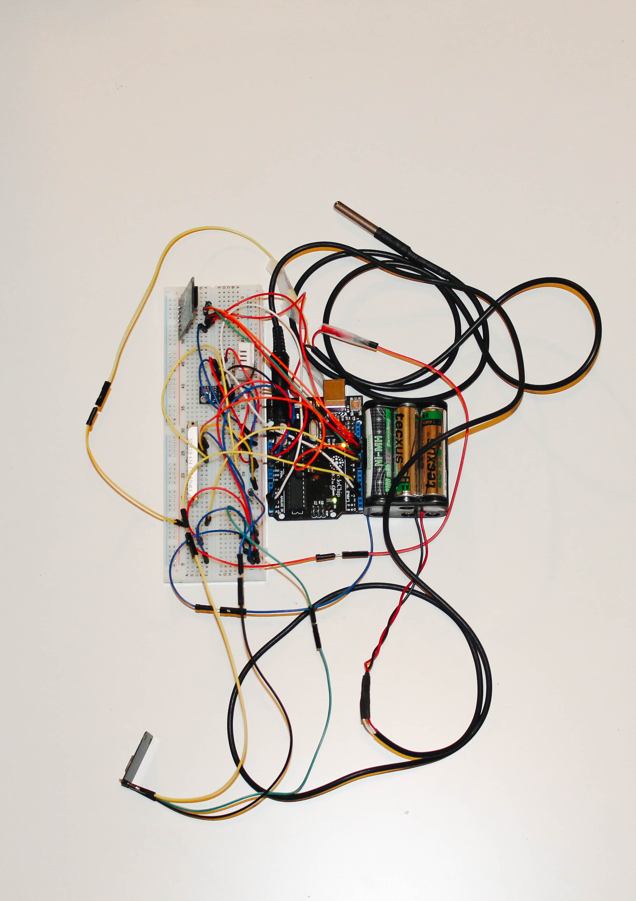
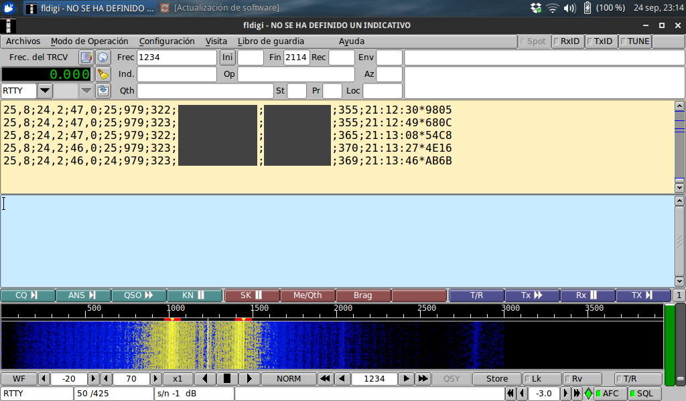
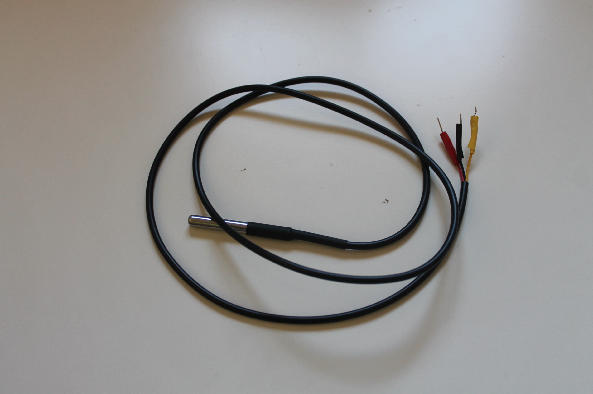
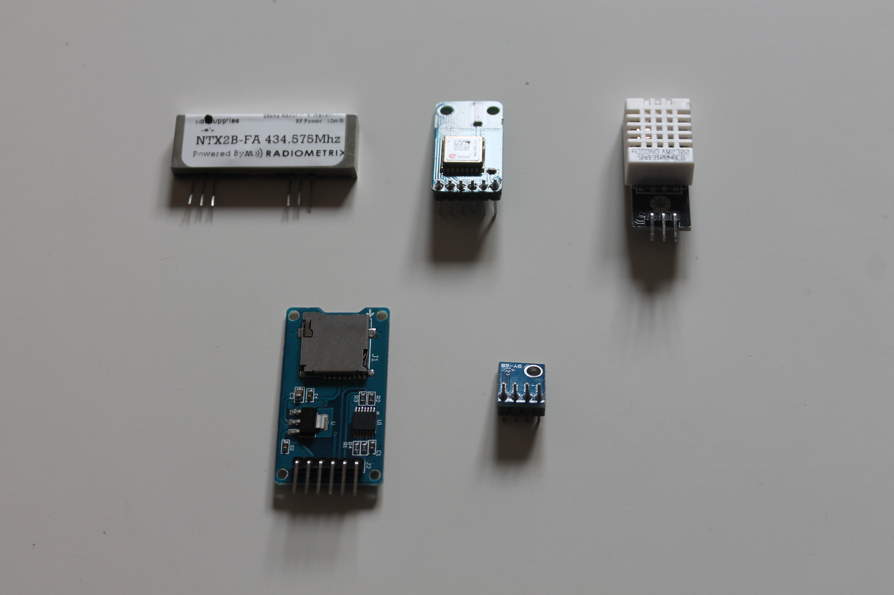

# sonda

Flight computer for a weather balloon / [high altitude balloon](https://ukhas.org.uk/doku.php?id=general:beginners_guide_to_high_altitude_ballooning) using an Arduino Uno.
The flight computer measures temperature (both inside and outside the payload), humidity, pressure, gets the position, altitude, and time with GPS, then formats the data for serial output, optional SD logging, and optional RTTY radio transmission.

Originally built as a school project in 2015.




## Hardware

Target board:

- Arduino Uno-compatible board -- tested on the Uno R3 (ATmega328P), but tight if both SD logging and radio transmission are enabled; larger AVR boards such as the Arduino MEGA R3 (ATmega2560) have larger memory and may be better suited in this case.
- Serial monitor speed: 38400 baud

If using an ATmega328P + ESP8266 board, upload the ATmega firmware with the board switch/jumper mode set to `USB+MCU`.

Sensors and modules:

- [DS18B20](https://randomnerdtutorials.com/guide-for-ds18b20-temperature-sensor-with-arduino/) external temperature sensor
- [DHT22](https://www.instructables.com/How-to-use-DHT-22-sensor-Arduino-Tutorial/) internal temperature and humidity sensor
- [BMP180](https://randomnerdtutorials.com/guide-for-bmp180-barometric-sensor-with-arduino/) internal temperature and pressure sensor -- it calculates the altitude as well but it's less reliable, see [Build, setup and upload](#build-setup-and-upload) section
- [u-blox GPS module](https://store.uputronics.com/products/ublox-max-m8c-pico-breakout-with-chip-antenna)
- [Catalex MicroSD card adapter](https://www.circuitstate.com/tutorials/interfacing-catalex-micro-sd-card-module-with-arduino/) for SD logging
- [Radiometrix NTX2B-FA](https://ukhas.org.uk/doku.php?id=guides:radio_modules:ntx2) radio transmitter on 434.075 MHz

See [WIRING.md](docs/WIRING.md) for more details on the specific wiring needed to reproduce the code.




## Layout

```text
platformio.ini   PlatformIO build environments
src/sonda.ino    Main firmware
lib/             Vendored Arduino libraries used for compatibility
LICENSE          Project license
```

The project vendors old Arduino IDE libraries under `lib/` so the firmware can be built without depending on a specific global Arduino IDE installation.

## Build, setup and upload

Install PlatformIO, then open this repository folder directly in VS Code / PlatformIO.

In the `sonda.ino` code, update the `ALTITUD` constant to the baseline (current) altitude. This is only to calibrate the altitude from the BMP180 during the flight:

```c
#define ALTITUD 330.0 // Altitude from which pressure measurement starts
``` 

Build and upload an environment

```powershell
pio run -e atmega328p_sensors_ext
pio run -e atmega328p_sensors_ext -t upload
```

PlatformIO usually finds the port automatically, otherwise it can be set when uploading:

```powershell
pio device list
pio run -e atmega328p_sensors_ext -t upload --upload-port [PORT]
```

Open the serial monitor at 38400 baud:

```powershell
pio device monitor -b 38400
```

The port can also be set manually,

```powershell
pio device monitor -p [PORT] -b 38400
```

## Libraries

The original firmware was written against Arduino IDE libraries installed manually years ago. Some of these libraries might have been updated and the latest version may not be compatible. To keep the current code compatible while migrating the project to PlatformIO, the required libraries are vendored under `lib/` and not pulled from PlatformIO.

Vendored libraries:

| Library | Used for |
| --- | --- |
| `OneWire` | DS18B20 external temperature sensor |
| `DHT_sensor_library` | DHT22 temperature and humidity sensor |
| `Adafruit_Unified_Sensor` | Dependency of the DHT library |
| `SFE_BMP180` | BMP180 pressure and temperature sensor |
| `TinyGPSPlus-0.94b` | GPS NMEA parsing |
| `SD-master` | SD card logging |


## Test environments

The firmware uses compile-time flags so subsystems can be tested independently without repeatedly commenting and uncommenting code.

Available environments:

| Environment | Purpose |
| --- | --- |
| `atmega328p_test` | Initializes only; does not read sensors and stops after 10 iterations |
| `atmega328p_dht` | Tests DHT22 temperature and humidity |
| `atmega328p_sensors` | Tests DHT22 and BMP180 |
| `atmega328p_sensors_ext` | Tests DS18B20 external temperature |
| `atmega328p_sensors_gps` | Tests GPS |
| `atmega328p_sensors_all` | Reads all sensors, without SD or radio |
| `atmega328p_radio` | Reads all sensors and transmits by radio |
| `atmega328p_sd` | Reads all sensors and logs to SD |
| `atmega328p_full` | Full firmware: sensors, GPS, SD, and radio |

The flags are defined in `platformio.ini`:

```ini
-DUSE_DS=1
-DUSE_DHT=1
-DUSE_BMP=1
-DUSE_GPS=1
-DUSE_SD=1
-DUSE_RADIO=1
```

Set a flag to `0` to exclude that subsystem from the build.

## Output

The main telemetry string is structured as:

```text
ds_temp;dht_temp;humidity;bmp_temp;pressure;bmp_altitude;lat;lng;gps_altitude;time;checksum
```

Example shape:

```text
27,7;24,3;60,0;22;1013;345;12.123456789;12.123456789;350;12:34:56*ABCD
```

Decimal values use a comma because the original firmware split decimal values into integer and decimal parts.

If SD card data logging is enabled, the telemetry strings are saved in the `sonda.txt` file.

To get the radio transmitted data it is necessary to use a radio receiver for 430-440 MHz and supporting SSB (single-sideband) such as the [Yupiteru MVT-7100](https://www.rigpix.com/yupiteru/mvt7100.htm); this data can then be decoded with [fldigi](https://sourceforge.net/p/fldigi/fldigi/ci/master/tree/).

## License

This project is currently licensed under GPLv3. Third-party libraries in `lib/` keep their own licenses and copyright notices.
